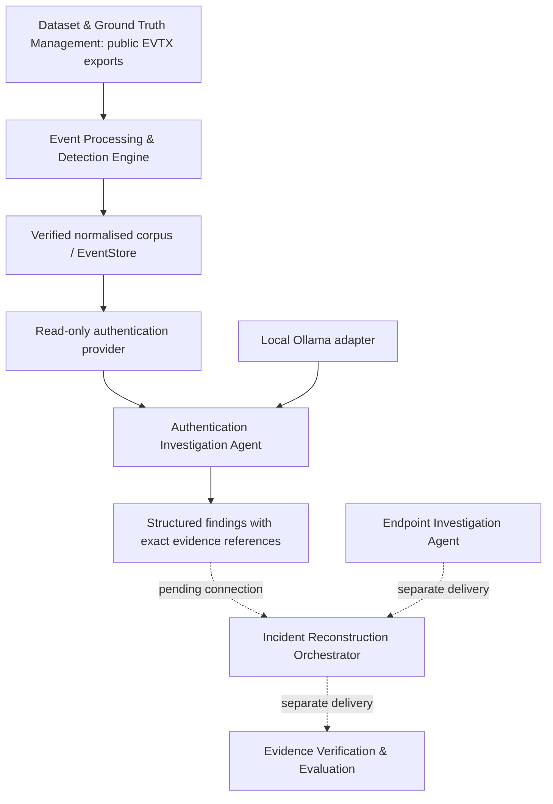

# Component names and current architecture

Use responsibility names in user interfaces, current documentation, reports and
future presentation material. The old numbers describe team assignments.

| Historical assignment | Component name | Compatible location |
| --- | --- | --- |
| M1 | Dataset & Ground Truth Management | `datasets/`, dataset scripts |
| M2 | Event Processing & Detection Engine | `m2/` |
| M3 | Authentication Investigation Agent | `m3/` |
| M4 | Endpoint Investigation Agent | Separate delivery |
| M5 | Incident Reconstruction Orchestrator | Separate delivery |
| M6 | Evidence Verification & Evaluation | Separate evaluation workflow |

Solid edges through authentication findings are implemented and exercised on
S01–S03. Dashed edges are dependencies, not claims of full pipeline integration.
No evaluation answer keys or scenario runbooks enter model context. Processing
baseline scoring is separate from authentication integration testing.

Keep `m2.query`, `m2.adapters.m3_provider.M2AuthenticationProvider`,
`m3.agent.investigate`, public schemas and entry points unchanged. Keep IDs such
as `S02-SEC-43584`, finding IDs beginning `M3-`, version strings such as
`m3-provisional-v1`, and historical file/PR references. These are stable machine
identifiers, not display names. `agent_type: authentication` already expresses
the result's responsibility, so no cosmetic schema field was added.

Historical reports retain their recorded names and results, with a notice
linking here. Current manuals and integration handoffs use component names.
