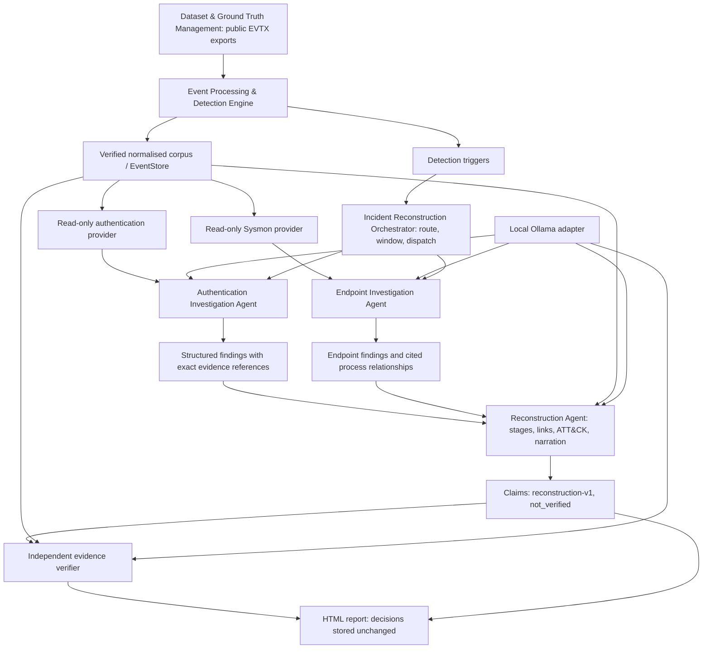

# Component names and current architecture

Components use responsibility names in packages, imports, commands, schemas,
reports and presentation material. Original scenario and evidence identifiers
remain unchanged.

| Component | Current location |
| --- | --- |
| Dataset & Ground Truth Management | `datasets/`, dataset scripts |
| Event Processing & Detection Engine | `event_processing/` |
| Authentication Investigation Agent | `authentication_agent/` |
| Endpoint Investigation Agent | `endpoint_agent/`, through `CorpusEndpointProvider` |
| Incident Reconstruction Orchestrator and Reconstruction Agent | `incident_reconstruction/` |
| Evidence Verification & Evaluation | `evidence_verification/`; verifier factory connects through `incident_reconstruction.verification`, evaluation reads saved artifacts separately |

The specialist pipeline and verifier connection are implemented. Select
`evidence_verification.agent:make_agent_verifier` for deterministic checks plus
the independent model prompt, or `evidence_verification.verifier:make_verifier`
for deterministic checks only. Omitting the factory uses `PendingVerifier`,
which leaves claims unverified. The single-agent baseline uses the same corpus
and triggers through its own bounded generalist loop.

No evaluation answer keys or scenario runbooks enter model context, including
the verifier. Post-run evaluation is separate: it compares saved artifacts with
private ground truth, independent human reviews and owner-approved definitions.
Automated integration and historical local-model measurements do not establish
current evaluation readiness; use the [evaluation workflow](FINAL_EVALUATION_HANDOFF.md).

The orchestrator turns detections into bounded, merged windows per agent, supplies trigger
evidence as trusted retrieval, records every outcome (including timeouts and context overflows,
which it retries on smaller windows) and never treats a failed investigation as clean. The
Reconstruction Agent builds stages, links findings and stages deterministically, and asks the
local model only to narrate each stage from enumerated evidence; every reply is re-checked. Three
run modes (`single-agent`, `multi-agent`, `full`) share triggers, providers, model and timing
points for the evaluation comparison. See the [package README](../incident_reconstruction/README.md)
and the [verification and evaluation handoff](RECONSTRUCTION_HANDOFF.md).

The endpoint boundary is `endpoint_agent.investigate`, backed by
`event_processing.adapters.endpoint_provider.CorpusEndpointProvider`.
Its installed command is `mair-investigate-endpoint`, result schema is
`endpoint-result-v1`, and finding IDs begin `ENDPOINT-`. It batches complete
observations and recovers capped retrieval within the existing query budget.
See the [endpoint manual](../endpoint_agent/README.md) and
[provider contract](ENDPOINT_PROVIDER_HANDOFF.md) for current behavior.

The public entry point is `authentication_agent.investigate`. The read-only
provider is `event_processing.adapters.authentication_provider.CorpusAuthenticationProvider`.
The installed distribution is `mair-incident-reconstruction` version 0.2.0;
commands are `mair-events`, `mair-authentication` and
`mair-investigate-authentication`.

Schema identifiers describe content: `security-event-v1`, `security-corpus-v1`,
`detection-run-v1`, `detection-score-v2`, `authentication-result-v2`,
`endpoint-result-v1`, `orchestration-run-v1`, `reconstruction-v1`, `pipeline-run-v1`,
`verification-report-v1` and `evaluation-results-v3`. Pipeline commands are `mair-orchestrate` and `mair-report`.
Finding IDs now begin `AUTH-`. Original evidence IDs such as `S02-SEC-43584`
and scenario IDs such as `S01` remain unchanged.

This is an intentional interface migration requested by the project owner.
Update downstream imports/configuration and regenerate derived corpora and
findings. No compatibility aliases for retired names are introduced. Earlier
recordings remain immutable in Git history; current artifacts are regenerated.
See the [migration guide](COMPONENT_NAMING.md) for the complete active interface.

Within the Authentication Investigation Agent, trusted application requirements
execute through the same bounded tools as optional model choices. The initial
query remains mandatory; the optional typed `RequiredOperations` list is not a
cross-agent plan. After it completes, the local model chooses whether to query
further, reviews results and selects tentative interpretations. Python computes
facts and validates references. Operation receipts distinguish these roles.
Exact duplicate operations reuse the immutable invocation snapshot and still
consume budget. See the [call boundary](ORCHESTRATOR_HANDOFF.md).
