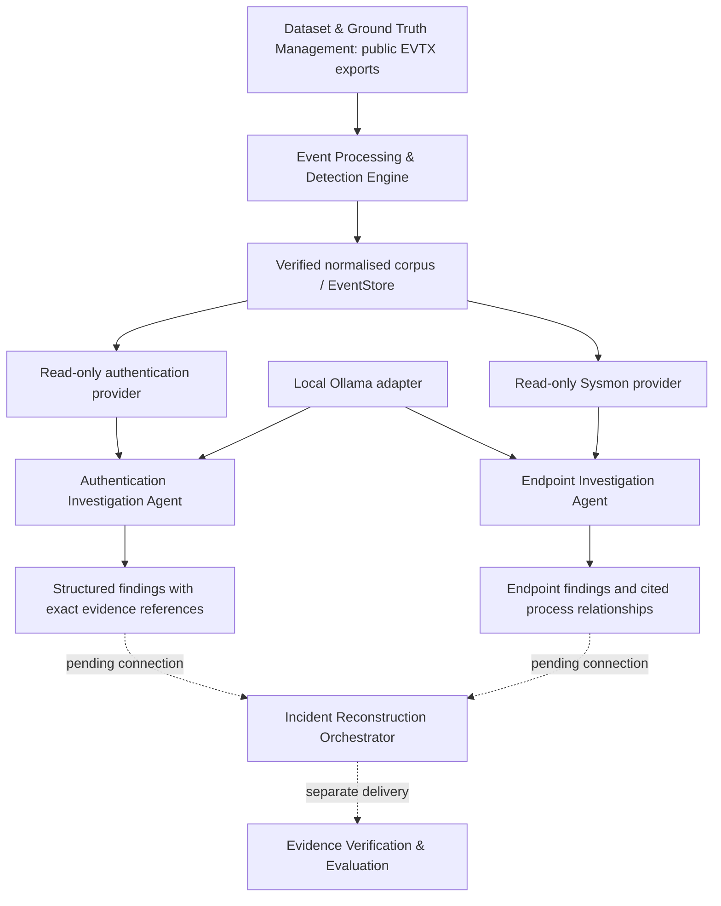

# Component names and current architecture

Components use responsibility names in packages, imports, commands, schemas,
reports and presentation material. Original scenario and evidence identifiers
remain unchanged.

| Component | Current location |
| --- | --- |
| Dataset & Ground Truth Management | `datasets/`, dataset scripts |
| Event Processing & Detection Engine | `event_processing/` |
| Authentication Investigation Agent | `authentication_agent/` |
| Endpoint Investigation Agent | `endpoint_agent/`, through `CorpusEndpointProvider` |
| Incident Reconstruction Orchestrator | Separate delivery |
| Evidence Verification & Evaluation | Separate evaluation workflow |

Solid edges through authentication findings are implemented and exercised on
S01–S03. Dashed edges are dependencies, not claims of full pipeline integration.
No evaluation answer keys or scenario runbooks enter model context. Processing
baseline scoring is separate from authentication integration testing.

Endpoint retrieval and deterministic findings are also exercised on the public
corpus using the fake model. Its local Ollama adapter reuses the existing transport;
Qwen3:8b smoke tests also completed on small public S01-S03 windows. These
validate integration, not autonomous investigation quality (see
[validation scope](ENDPOINT_IMPLEMENTATION.md#validation-scope)). The callable
boundary is `endpoint_agent.investigate`, backed by
`event_processing.adapters.endpoint_provider.CorpusEndpointProvider`.
Its installed command is `mair-investigate-endpoint`, result schema is
`endpoint-result-v1`, and finding IDs begin `ENDPOINT-`. See the
[endpoint handoff](ENDPOINT_PROVIDER_HANDOFF.md).

The public entry point is `authentication_agent.investigate`. The read-only
provider is `event_processing.adapters.authentication_provider.CorpusAuthenticationProvider`.
The installed distribution is `mair-incident-reconstruction` version 0.2.0;
commands are `mair-events`, `mair-authentication` and
`mair-investigate-authentication`.

Schema identifiers describe content: `security-event-v1`, `security-corpus-v1`,
`detection-run-v1`, `detection-score-v1` and `authentication-result-v2`.
Finding IDs now begin `AUTH-`. Original evidence IDs such as `S02-SEC-43584`
and scenario IDs such as `S01` remain unchanged.

This is an intentional interface migration requested by the project owner.
Update downstream imports/configuration and regenerate derived corpora and
findings. No compatibility aliases for retired names are introduced. Earlier
recordings remain immutable in Git history; current artifacts are regenerated.
See the [migration guide](COMPONENT_NAMING.md) for the complete active interface.

Within the Authentication Investigation Agent, trusted application requirements
execute through the same bounded tools as optional model choices. The initial
query remains mandatory; the optional typed `RequiredOperations` list is not a
cross-agent plan. After it completes, the local model chooses whether to query
further, reviews results and selects tentative interpretations. Python computes
facts and validates references. Operation receipts distinguish these roles.
Exact duplicate operations reuse the immutable invocation snapshot and still
consume budget. See the [call boundary](ORCHESTRATOR_HANDOFF.md).
